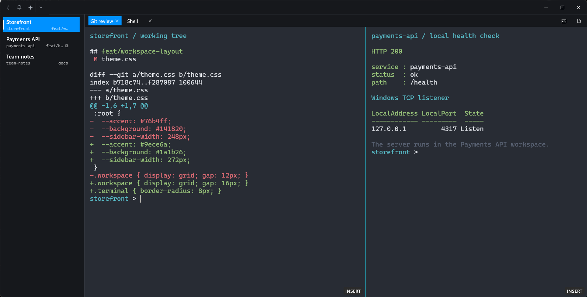
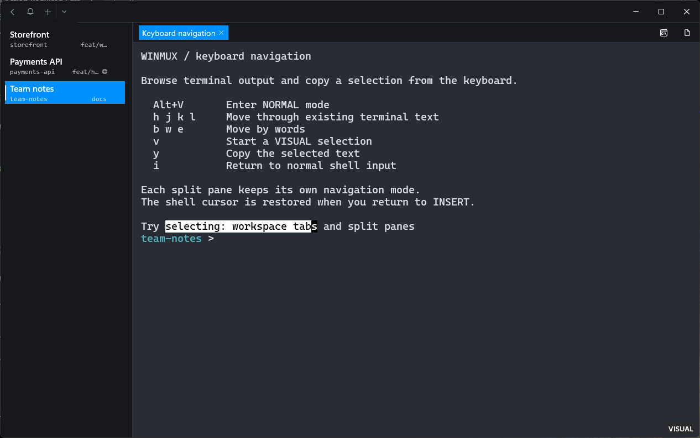
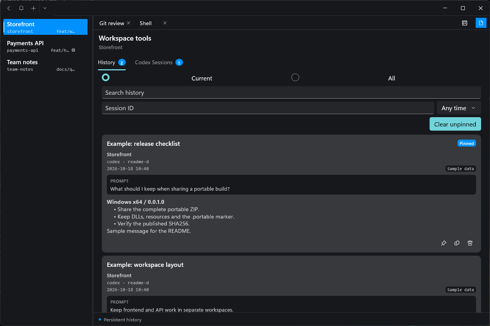

# Winmux

简体中文 | [English](README.en.md)

**Windows 上的多项目终端工作区。**

Winmux 基于 Windows Terminal 的原生终端引擎，把项目工作区、终端标签、分屏、键盘选区和 Codex 本地历史放进同一个桌面应用。适合同时处理多个项目、运行开发服务和命令行编码工具。

[下载版本](https://github.com/resiblaz/winmux/releases) · [使用指南](doc/user-docs/WorkspaceSidebar.md) · [构建与部署](AGENT.md) · [发布流程](doc/releasing.md) · [反馈问题](https://github.com/resiblaz/winmux/issues)



*实际运行的 `0.0.1.0` Windows x64 便携版。左侧切换项目，顶部切换当前项目的终端，分屏同时查看 Git diff 和 HTTP 200 响应；后台 API 服务监听本机 `4317` 端口。截图使用隔离的示例项目和自定义配色、字号，详见[截图说明](doc/images/readme/README.md)。*

## 先分清三个层级

| 层级 | 用途 | 截图中的例子 |
| --- | --- | --- |
| 工作区 | 按项目组织终端，可命名、置顶、排序 | 左侧的 Storefront、Payments API、Team notes |
| 终端标签 | 在同一工作区中分开不同任务 | Storefront 中的 Git review、Shell |
| 分屏 | 在一个终端标签里并排运行多个终端 | 左边看代码差异，右边请求后台 API |

工作区名称与终端标题独立保存。切换终端、关闭某个终端或恢复窗口布局时，项目名称可以保持不变。

## 快速开始

**发布目标：Intel/AMD Windows x64；基准版本：`0.0.1.0`。** 系统要求 Windows 10 2004（build 19041）及以上，或 Windows 11。

1. 在 [Releases](https://github.com/resiblaz/winmux/releases) 下载 `winmux_<version>_windows_x64.zip`。页面暂时没有 ZIP 附件时，可使用下方的[源码构建](#源码构建)。
2. 完整解压压缩包，保留 DLL、资源文件、`settings/` 和 `.portable` 标记。
3. 进入 `winmux-<version>` 目录，运行 **`winmux.exe`**。

便携版默认启用工作区侧栏、窗口布局恢复和 Vim 导航。设置与本地状态保存在应用旁的 `settings/` 目录。

`winmux.exe` 是图形界面入口；**`wmx.exe`** 用于命令行输出和工作区快照操作。例如，列出已保存的快照：

```powershell
.\wmx.exe workspace list --format json
```

## 日常操作

| 快捷键 | 操作 |
| --- | --- |
| `Ctrl+N` | 新建工作区 |
| 按住 `Ctrl` 输入 `1`～`99`，松开确认 | 切换到对应工作区；例如按住 `Ctrl` 输入 `12` 后松开 |
| 按住 `Alt` 输入 `1`～`99`，松开确认 | 切换当前工作区内的对应终端；两套编号独立 |
| `Ctrl+R` | 重命名当前工作区 |
| `Alt+N` / `Ctrl+Shift+T` | 在当前工作区中新建终端，沿用活动分屏的目录 |
| `Ctrl+Shift+P` | 打开命令面板，可搜索分屏等动作 |
| `Alt+V` | 进入终端输出的 Vim 导航 |
| `Ctrl+Shift+U` | 跳转到最新的未读通知来源 |

侧栏右键菜单提供置顶、重命名、关闭和通知操作；拖动工作区可以排序，拖动侧栏右边缘可以调整宽度。快捷键可在 Settings → Actions 中修改。

## 已实现的能力

| 能力 | 实际行为 |
| --- | --- |
| 项目上下文 | 侧栏显示工作目录、本地 Git 分支和终端进程树中的 Windows TCP 监听端口 |
| 工作区与分屏 | 每个工作区包含多个终端标签，每个标签可继续分屏 |
| 布局恢复 | 正常退出后，恢复工作区、终端、分屏、目录、选中状态、名称和置顶顺序 |
| 通知与状态 | 接收终端通知，显示未读、进度等状态，并跳转到来源分屏 |
| Codex 本地历史 | 接入 Hook 后，保存提示与结论，支持搜索、筛选、置顶和复制 |
| 快照与自动化 | `wmx workspace` 可列出、打开、导入和导出已保存的快照；另提供本地 Named Pipe API |

**布局恢复会重新启动 Shell。** 正在运行的服务、命令和进程内存需要重新启动。关闭单个终端会将它从待恢复布局中移除；希望下次恢复时，应保留需要的终端并正常退出整个应用。

目录跟踪依赖 Shell 通过 OSC 7 或 OSC 9;9 上报目录。Git 查询面向本地 Windows 目录；端口发现面向 Windows 子进程的 TCP 监听，不包含 SSH 远端或 WSL 服务进程中的监听端口。配置方法见[使用指南](doc/user-docs/WorkspaceSidebar.md#workspace-context-and-notifications)。

### 用键盘浏览和复制终端输出

`Alt+V` 进入 NORMAL，使用 `h/j/k/l` 或方向键移动，`b/w/e` 按词移动；按 `v` 开始 VISUAL 选区，移动后按 `y` 复制，`i` 或 `a` 返回 INSERT 输入。



*图中选区通过实际键盘操作产生，右下角显示当前分屏的 VISUAL 状态。每个分屏独立维护导航模式。*

导航命令使用英文键位，使用输入法时请先切换到英文输入。INSERT 模式中的 `Esc` 会正常交给 Shell 或 Codex；使用备用屏幕的 nvim 等应用保留自己的键盘操作。

### 查看 Codex 提示与结论

在工作区右上角打开工具页，进入 **History**，可以按当前工作区或全部工作区查看记录，搜索内容、筛选会话与日期，并置顶或复制条目。记录保存在本机。



*History 截图中的消息明确标记为 Sample data，经本地 `history.ingest` 接口写入，用于展示真实的历史存储和界面功能。*

**自动记录 Codex 对话需要配置 Hook。** 获取本仓库源码后，在仓库根目录执行：

```powershell
pwsh -NoLogo -NoProfile -File .\.codex\hooks\install-workspace-history.ps1
```

该脚本配置当前用户的 Codex Hook。卸载使用同目录的 `uninstall-workspace-history.ps1`。其他命令行编码工具可以在终端中运行；自动历史接入以当前提供的 Codex Hook 为准。

## 设置与升级

- 便携版设置、会话状态与本地历史位于 `settings/`。注册安装版使用独立的设置存储。
- 手动升级前正常关闭 Winmux，备份现有 `settings/`，将新包解压到新目录，再迁移设置。
- 不启用 Vim 导航时，在 `profiles.defaults` 或单个 Profile 中设置 `"experimental.vimMode": false`。
- 使用已有设置时，可通过 Settings → Appearance → Tab layout → Workspace sidebar 启用侧栏。

本地历史功能在设备上存储记录。终端中运行的 Shell、编码工具和 AI 服务各自决定其网络行为。

## 源码构建

需要 Windows、PowerShell 7、Visual Studio C++/UWP 构建工具及仓库使用的 Windows SDK。完整约定见 [AGENT.md](AGENT.md)。

```powershell
git clone --branch develop https://github.com/resiblaz/winmux.git
cd winmux

# 在同一增量构建图中构建应用与原生测试，并运行验收。
pwsh -NoLogo -NoProfile -File .\tools\deploy\test-workspace-release.ps1

# 复用已验收产物，打包并启动便携版。
pwsh -NoLogo -NoProfile -File .\tools\deploy\build-portable-release.ps1 -SkipBuild
```

保留 `bin/`、`obj/`、生成文件和依赖缓存，日常开发使用增量构建。GitHub 发版采用“准备发布包 → 上传草稿 → 校验后发布”，见[发布文档](doc/releasing.md)。

## 当前范围

- GitHub 发布包仅面向 **Windows x64**。
- 项目内没有嵌入式浏览器；终端中可以运行命令行程序。
- 通知历史保留在当前进程中；Codex 本地历史单独持久化。
- 本地自动化 API 的终端输入与内容读取权限默认关闭，按需要分别启用。

## 文档与致谢

- [工作区、Vim、通知与自动化指南](doc/user-docs/WorkspaceSidebar.md)
- [增量构建与本地部署](AGENT.md)
- [GitHub 发布流程](doc/releasing.md)
- [0.0.1.0 基准版本说明](doc/releases/0.0.1.0.md)
- [报告问题](https://github.com/resiblaz/winmux/issues)

Winmux 基于 [Microsoft Windows Terminal](https://github.com/microsoft/terminal)，工作区交互受到 [cmux](https://github.com/manaflow-ai/cmux) 启发。原始版权声明、[MIT 许可证](LICENSE)及第三方声明均予以保留。
