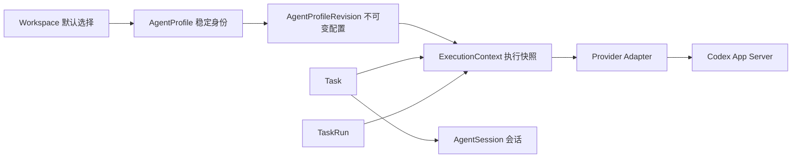

# 自定义 Agent 设计

状态：用户已于 2026-09-06 授权按本设计开发。首版 A–C 已实现并通过增量构建、原生回归及隔离实机验证，D 项扩展保持后续范围。
本文保留设计依据；本轮实际接口与验证状态见[首版实现记录](implementation.md)。

分支：`feature/custom-agents`；主分支基线：`d0f6871c1`。相关约束见
[Task 架构决策](../task-driven-terminal/architecture-decision-register.md)和
[架构收尾记录](../task-driven-terminal/architecture-hardening-2026-09-05.md)。

## 目标与范围

用户可以保存“代码审查”“功能实现”等长期角色，在创建 Task 时选择，
查看每次执行实际使用的配置，并复制、修改、归档这些角色。
一个 Agent 可以被多个 Task 使用，每个 Task 仍拥有自己的 Run 和会话。

首版以现有 Codex App Server 为执行后端，提供名称、简介、指令和模型覆盖。
模型留空表示使用运行环境默认值。后续扩展思考强度、速度档、Skills、MCP 和
独立 CLI 后端时，先完成对应的能力探测与隔离，再开放界面字段。

## Multica 参考及本仓库适配

参考本地只读 `.references/multica`，提交
`64ec7f54163d918d5d7fd4dcae857f241b7842d0`。仅借鉴概念与行为；不引入其源码或 UI 资产。

| 参考事实 | 源码/文档依据 | 本设计采用的方式 |
| --- | --- | --- |
| Agent 保存身份与长期配置，Runtime 表示实际执行环境 | [创建说明](https://github.com/multica-ai/multica/blob/64ec7f54163d918d5d7fd4dcae857f241b7842d0/apps/docs/content/docs/agents-create.zh.mdx)、[类型定义](https://github.com/multica-ai/multica/blob/64ec7f54163d918d5d7fd4dcae857f241b7842d0/packages/core/types/agent.ts) | AgentProfile 与 Provider、AgentSession 分离 |
| 简介用于展示，指令进入执行；模型等覆盖值可留空 | 同上；[创建配置面板](https://github.com/multica-ai/multica/blob/64ec7f54163d918d5d7fd4dcae857f241b7842d0/packages/views/agents/create/agent-configuration-panel.tsx) | 简介不注入提示；预览明确显示将发送的长期指令 |
| 领取任务时传递 agent 配置，再转换为执行选项 | [TaskAgentData](https://github.com/multica-ai/multica/blob/64ec7f54163d918d5d7fd4dcae857f241b7842d0/server/internal/handler/agent.go)、[daemon 执行](https://github.com/multica-ai/multica/blob/64ec7f54163d918d5d7fd4dcae857f241b7842d0/server/internal/daemon/daemon.go) | 按现有 ADR-TASK-026，在创建执行上下文时固定配置；排队及重试期间不追随最新 Agent |
| 复制可复用工作配置，凭据和 MCP 配置不复制 | 创建说明；[复制草稿](https://github.com/multica-ai/multica/blob/64ec7f54163d918d5d7fd4dcae857f241b7842d0/packages/views/agents/create/use-duplicate-draft-seed.ts) | 新 ID、新名称；首版只复制非敏感字段 |
| 自定义 RuntimeProfile 与 RuntimeDevice 分开，包含协议族、命令和参数数组 | 类型定义中的 RuntimeProfile | 自定义 CLI 后端作为另一层扩展，不能把任意命令当作已支持 Task 协议的 Agent |
| 团队工作区有调用权限、机器绑定和独立并发限制 | 创建说明、Agent 类型 | 本地单用户首版使用当前 Runtime 数据根内的 Agent 库，Workspace 仅保存默认选择；不引入团队权限模型 |

## 对象关系



AgentProfile 不拥有进程、终端或会话。不同 Task 即使使用同一 Agent，也不能共享
provider thread、Run capability 或工作目录租约。Agent 的“运行中 N 项”从活动 Run
投影计算；保存角色配置不会启动模型请求。

## 界面与操作

在 Tasks 的新建/配置面板中增加“Agent”选择器，末项为“管理 Agent”。管理页是
独立的原生页面，由自己的 ViewModel 管理；TerminalPage 只负责导航。

```text
Agent                                      [+ 新建]
搜索…                                      [显示已归档]
代码审查       Codex · 默认模型       运行中 1 项
功能实现       Codex · 指定模型       空闲

名称           [代码审查                         ]
简介           [检查改动并整理可操作的问题       ]
执行后端       Codex
模型           [使用运行环境默认值              ]
长期指令       [先读仓库指令；检查正确性与测试… ]
               [预览执行指令]
               [保存] [复制] [归档]
```

新建 Task 先读取 Workspace 默认 Agent，用户可以改选“本次自定义”。界面显示
Agent 名称及已保存版本、模型和指令摘要。保存 Agent 与“保存并运行 Task”是两个动作。
在 Task 详情的运行历史里，显示当次 Agent 名称快照、配置版本及模型请求值。

编辑时保留本地草稿；保存失败继续保留输入，明确展示校验或版本冲突。
另一窗口已更新时提供“重新加载”和“另存为新 Agent”，不静默覆盖。
归档会列出受影响的 Workspace 默认项；历史详情继续可读。

## 配置生效规则

| 操作 | 规则 |
| --- | --- |
| 创建 Agent | 保存 revision 1；只做字段验证，不执行 Task |
| 更新 Agent | 以 expectedProfileVersion 做 CAS，追加配置 revision；已创建的 Task 不自动变化 |
| 创建 Task | Runtime 在同一事务校验 Agent ID/revision、归档状态并固定配置；版本冲突要求刷新选择 |
| Task 后续消息 | 使用该 Task 当前固定的 ExecutionContext |
| Task 更新 Agent 配置 | 显式选择新版本，显示差异；只允许无活动/排队 Run、无未完成 intent 时追加 ExecutionContext |
| 重试历史 Run | 使用原 Run.ExecutionContext，不读取最新 Agent 或最新 Task 配置 |
| 修改 Agent 名称/简介 | 新 revision；历史使用名称快照，当前 Agent 链接可展示现名称 |
| 归档 Agent | 不出现在新选择中，清除关联 Workspace 默认值；已固定配置的 Task 仍可继续/重试，不取消现有 Run |
| 恢复 Agent | 恢复可选状态，不自动恢复 Workspace 默认选择 |
| 删除 Agent | 首版仅归档；不物理删除被 Task/历史引用的配置 |

更换 Agent 或更新影响执行的配置后，下一次 Run 创建新 AgentSession，保留旧会话历史，
避免旧指令残留。仅改名/简介不要求换会话。首版只需支持 Codex；以后切换 Provider
同样通过新会话处理。运行目录、执行模式和成果分支继续遵循 ADR-TASK-026 的冻结规则。

“默认模型”是一项请求策略，不是已解析模型名。每次 Run 记录实际请求值；Provider
能返回最终模型时再单独记录 resolvedModel，不能声称空值可精确重现 CLI 默认配置。

## 数据与协议

Runtime 仍是 SQLite 唯一写入者，建议新增：

| 数据 | 内容 |
| --- | --- |
| agent_profile | UUID、version、current_revision、archived_at、created_at、updated_at |
| agent_profile_revision | (agent_id, revision) 主键；name、description、provider、model_override、instructions、created_at |
| workspace_agent_default | workspace_id 主键；agent_id；独立 CAS revision |
| execution_context 扩展 | 可空的 source_agent_id/source_agent_revision、agent_name_snapshot；已有 Provider/Model/Instructions 保存执行值 |
| agent_command_receipt / agent_event | Agent 命令幂等与独立事件游标；不递增任何 Task 的业务版本 |

首版草案限制：名称去首尾空格后 1–80 个 Unicode 标量，拒绝控制字符；简介不超过
1 KiB UTF-8，指令不超过 32 KiB UTF-8，模型标识不超过 256 字节并拒绝 NUL/控制字符。
UUID 是身份，名称允许重复，选择器用短 ID 消歧。归档前后的名称均不参与外键。
空模型映射为无覆盖。拒绝未知 Provider，不把不可用模型静默替换成另一模型。

建议新增独立 Agent RPC：List/Get/Create/Update/Archive/Restore/SetWorkspaceDefault，
每个写命令携带 commandId、payloadHash 及对应聚合的 expectedVersion；返回 committed version
与 event cursor。List 使用分页和有界响应；Agent 编辑内容只在 Get 中返回。
CreateTask 可选携带 agentId+agentRevision；不允许同时提交完整 Agent 配置覆盖，
“本次自定义”使用已有 Provider/Model/Instructions 草稿路径。

Profile.version 用于管理命令 CAS，归档/恢复同样递增；current_revision 只在追加配置
快照时前进。事件游标独立。是否需要新会话按 Provider/Model/Instructions 等执行字段
比较，名称/简介变化不改变执行配置指纹。

Agent RPC 使用桌面客户端能力，与发给执行中 Agent 的 rtask 能力分开。Agent 的
运行时 capability 不获得创建、编辑其他 Agent 配置的权限。

## 原生实现边界及现有代码缺口

| 层 | 建议职责 |
| --- | --- |
| TaskCore | AgentProfile 记录、校验、归档/版本策略、事务与迁移；独立文件，不扩成 TaskRecords 的杂项区 |
| TaskRuntime | RuntimeAgentCatalogService；解析选择并固定执行快照；Agent 事件订阅 |
| TaskRuntimeProtocol / Client | Agent DTO、编解码、校验及客户端查询/命令 |
| TaskProvider | 只接受解析后的执行配置；能力探测和 SDK 参数映射 |
| TerminalApp/Agents | AgentCatalogPage、AgentEditorViewModel、AgentCatalogCoordinator |
| TerminalApp/Tasks | Agent 选择器、版本提示和历史展示，复用 Runtime 命令通路 |

实现前必须处理两处接入缺口：

1. [RuntimeTaskRunExecutor.cpp](../../../../src/cascadia/TaskRuntime/RuntimeTaskRunExecutor.cpp) 的 `_context` 当前取最高 Revision。新增可编辑配置后必须
   按 `TaskRunRecord.ExecutionContext` 查找，并在准备、启动、恢复路径保持同一快照；
   否则历史重试会执行新配置。
2. [RuntimeTaskProviderService](../../../../src/cascadia/TaskRuntime/RuntimeTaskProviderService.h) 当前共享一个 Provider。首版沿用同一 Codex 进程，
   将长期指令和模型注入各 Task 会话；进程级环境、任意 CLI 参数、托管 MCP 必须在
   增加 Provider 实例分组/隔离之后支持，不能通过改共享进程污染其他 Agent。

长期指令以明确的“Agent 指令”段加入现有 Task 运行上下文，Task 描述及跟进消息保留
独立边界。展示简介不发送给模型。仓库自己的 AGENT.md/AGENTS.md 文件由现有 Provider
加载路径处理，不为应用 Agent 设置改写仓库指令文件。

## 分阶段落地与验收

A. 数据及协议：新增可回滚迁移、Agent 库 CRUD/归档、CAS 与幂等；旧 Task 的 source
字段为空，继续使用既有配置，不自动改写历史。旧二进制遇到新 schema 应明确拒绝，
回退使用升级前备份，而不是尝试降级写库。

B. 交互：管理页、创建/复制/归档、Workspace 默认值和新建 Task 选择器；用户已授权依照
本文草图推进原生实现。保存错误和跨窗口更新可见。

C. 执行：按 Run 固定配置、配置变更新建会话、运行历史展示；两名不同 Agent 在两个
Task 同时执行，验证指令/模型/能力隔离。只保存不启动，归档不打断运行。

D. 可选扩展：实时模型目录和思考强度/速度档、Skills、MCP/凭据隔离、自定义 Runtime
后端、Agent 独立并发上限、AI 创建草稿；各自有单独能力与恢复验证。

必须覆盖：更新后旧排队 Run 不变、旧 Run 重试固定原版本、显式更新配置后新会话、
归档期间活动任务继续、旧库迁移、重连、两窗口编辑冲突、receipt 重放、中文边界及
超长输入、协议不支持字段的错误反馈。实现后的验证沿用仓库统一增量 Release gate。

首版作用域、归档语义与字段按本设计实现。参考仓库仅提供概念依据；D 项扩展不因
参考项目已有实现而自动纳入本轮范围。
