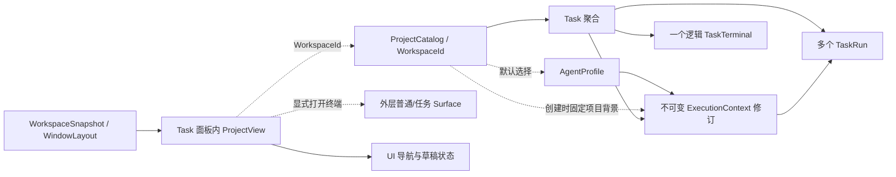
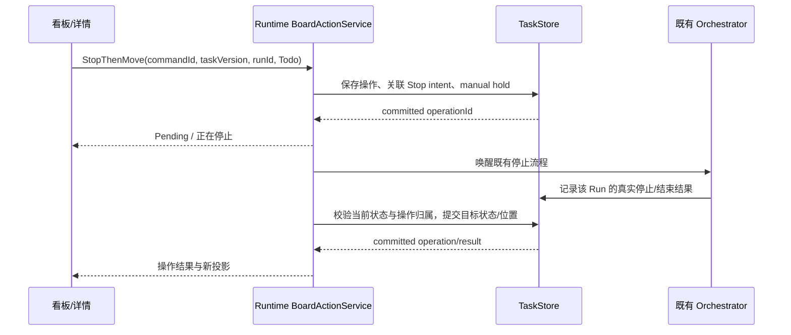

# 技术架构与数据契约

本文保留设计基线和数据契约；本次新增能力已在 `feature/workspace-projects` 实现。
具体落点及验证见[实现记录](implementation-status.md)和[验证记录](validation.md)。
交互定义见[交互规范](interaction-spec.md)。

## 1. 现有实现及缺口

| 代码依据 | 已存在的能力 | 本次需要补齐 |
| --- | --- | --- |
| [TaskRecords.h](../../../../src/cascadia/TaskCore/TaskRecords.h) | Task 持有 WorkspaceId，Run 引用 ExecutionContext | 项目元数据；项目背景快照；看板顺序 |
| [TaskStatusPolicy.cpp](../../../../src/cascadia/TaskCore/TaskStatusPolicy.cpp) | 七种状态、用户/Agent/恢复权限及完成条件 | 显式看板意图及复合操作策略 |
| [SqliteTaskStoreRuns.cpp](../../../../src/cascadia/TaskCore/SqliteTaskStoreRuns.cpp) | 一个 Task 最多一个活动 Run，幂等与 manual hold | 状态、Run、消息领取与落点的复合事务 |
| [RuntimeTaskProjectionQuery.cpp](../../../../src/cascadia/TaskRuntime/RuntimeTaskProjectionQuery.cpp) | 查询完整聚合并按 512 项上限返回 | 有界摘要页、总数、按需详情和游标语义 |
| [TaskProjectionCoordinator.h](../../../../src/cascadia/TerminalApp/Tasks/TaskProjectionCoordinator.h) | epoch/generation 投影合并 | 摘要页成员与实体缓存分开；不能把一页当作完整集合 |
| [TaskPage.xaml](../../../../src/cascadia/TerminalApp/Tasks/TaskPage.xaml) | 范围/搜索/筛选、列表、完整详情和草稿 | 双视图及可保存的导航上下文 |
| [AgentCatalogPage.xaml](../../../../src/cascadia/TerminalApp/Agents/AgentCatalogPage.xaml) | 完整 Agent 管理与 Workspace 默认值 | 全局导航入口及草稿返回栈 |
| [WorkspaceCollection.h](../../../../src/cascadia/TerminalApp/WorkspaceCollection.h) | 按 Workspace 分组的实时 Surface 集合 | 不承担无终端项目的持久目录 |
| [WorkspaceSnapshotCoordinator.cpp](../../../../src/cascadia/TerminalApp/WorkspaceSnapshotCoordinator.cpp) | 快照保存/重放保持 WorkspaceId | 项目打开、关闭视图与布局恢复衔接 |

设计基线的数据库 schema 为 5、协议为 1.3。本次实现将
[数据库 schema](../../../../src/cascadia/TaskCore/TaskStoreSchema.h) 升级为 6，
[协议](../../../../src/cascadia/TaskRuntimeProtocol/ProtocolVersion.h) 升级为 1.4，
通过可选能力协商保留旧客户端路径。

## 2. 身份和所有权



### 2.1 一个稳定 ID

`ProjectRecord.Id` 使用现有 `WorkspaceId` 类型；数据库、协议继续使用
`workspace_id` / `workspaceId` 字段。界面将其称为项目，不再引入需要整体映射
Task 外键的第二套 Project UUID。

- Project 名称、目录和 Git 分支不充当身份。
- WorkspaceSnapshot.Id 是布局快照身份，不用它替换 Project/WorkspaceId。
- TaskId、ExecutionContextId、RunId、AgentProfileId 和它们的历史引用保持原值。
- 同一窗口内一个项目只打开一个 ProjectView；跨窗口可查看同一项目，共享业务
  数据，保留独立的导航/布局状态和既有单输入控制权。
- 导入“副本”布局得到新 WorkspaceId 时，可创建新项目记录，但不复制 Task、Run、
  AgentSession 或执行能力；同 ID、不同目录的导入要展示冲突，不能覆盖项目根。

### 2.2 持久项目与实时终端

原有 WorkspaceSidebar 与实时 `WorkspaceCollection` 继续管理终端分组、显示和导航。
ProjectCatalog 的项目选择工具栏及管理页面只挂载到 TaskPanelHost，切换到终端或总结
时整体隐藏；项目刷新不改外层侧栏、Surface 列表、终端新建规则或当前 Workspace。

`ActiveProjectId` 由项目导航持有。创建任务、筛选、Agent 默认设置和标题不再从
当前终端反推项目。只有项目概览中显式“打开终端”传入项目 ID；外层普通新建终端
仍使用当前 Workspace。项目可有零个普通/任务 Surface。

终端的 cwd 和标题变化只更新终端视图。项目绑定、名称修改必须使用项目命令。
现有显式 CLI/横向标签临时会话保持兼容；需要持久项目能力时将其登记为旧式未绑定
项目，再进行显式目录绑定，不自动把任意 shell cwd 当作项目根。

### 2.3 数据归属

| 数据 | 权威所有者 | UI 使用方式 |
| --- | --- | --- |
| 项目元数据与归档状态 | Runtime / SQLite | 项目投影与命令 |
| Task、Run、消息、生命周期、执行配置 | 现有 Runtime / TaskStore | 复用投影和既有命令 |
| Agent 与项目默认值 | 现有 AgentCatalog | 继续使用 ID/revision 和独立 CAS |
| 看板位置与列 revision | Runtime / SQLite | 排序命令与增量刷新 |
| 窗口、选中项目、视图偏好、布局引用 | UI / ApplicationState、WindowLayout | 合并保存 UI 状态，不写业务表 |
| 未提交的任务、消息和 Agent 草稿 | 当前窗口的 DraftSessionStore | 按项目/Task/Agent/draft ID 保留，不被控件重建或刷新覆盖 |
| 普通终端历史和 Summary | 原有组件 | 项目导航关联；不复制 Task 内容 |

首版对草稿保证窗口内导航、项目切换和管理页往返保留；保存之后才获得 Runtime
持久性保证。退出窗口仍有未提交输入时提供保存、丢弃、继续编辑；不声称可以从
崩溃中恢复未提交文字。UI 偏好持久化不包含原始终端内容、Run capability 或输入租约。

## 3. 新增数据

### 3.1 表与记录

| 表/记录 | 关键字段 | 不变量 |
| --- | --- | --- |
| `project` | workspace_id PK、version、name、description、kind、binding_state、root_path、root_identity_digest、archived_at、origin、created_at、updated_at | ID 稳定；版本用于元数据 CAS；根可在旧数据待绑定时为空 |
| `task_board_position` | task_id PK/FK、rank | 列/项目归属从 Task 推导；移动不改优先级；Task 删除级联移除位置 |
| `project_board_column` | workspace_id + bucket PK、revision | bucket 为四主列及两个辅助区；受阻是进行中内的独立分组 |
| `project_event` | 全局 sequence、workspace_id、可空 task_id、kind、相关版本、有界变更摘要 | 用于项目/看板/摘要失效通知，不复制完整 Task 历史 |
| `project_command_receipt` | command_id、payload_hash、workspace_id、提交结果 | 不挪用 Task 命令的身份或版本 |
| `board_command_receipt` | command_id、payload_hash、task_id、项目/列版本、结果、可空 operation_id | 纯排序不用递增 Task 业务版本 |
| `task_board_operation` | operation_id、command_id、task_id、related_run_id、intent_id、源状态、目标状态、effect、stage、reason | 外部动作有持久关联；不能中断另一个 Run 或重复创建执行 |
| `task_board_note` | task_id、text、kind、created_at | 保存人工交付/受阻说明，由任务投影读取 |
| `task_board_undo` | command_id、task_id、原状态/hold/相邻卡片/说明、Task 与两列版本、undone_by | 仅排序和计划移动可撤销；版本不符拒绝，不覆盖后续操作 |
| `task_owned_session` | sequence、provider_session_id UNIQUE | 只追加归属标记；Task 删除不移除，用于普通 Summary/History 排除 Task 会话 |

Agent 的 `workspace_agent_default` 保留原表与 API，不再复制到 `project` 中作为第二
写入源。项目查询通过该表展示默认选择。

ExecutionContext 追加可空的项目版本、项目名和项目说明快照字段。旧上下文保持空；
新 Task 的项目背景、Agent 选择和 Task 配置在同一创建事务固定。对已创建 Task
更新项目背景，需要无活动/排队 Run 和未完成 intent，并追加显式上下文修订。
影响提示内容的修订遵守已有新会话/执行配置指纹规则。

项目描述建议限制 16 KiB UTF-8，名称沿用 1–80 Unicode 标量及控制字符校验。
路径用 [DirectoryIdentity](../../../../src/cascadia/TaskExecution/DirectoryIdentity.h)
的既有策略验证，不放宽系统目录、链接或 UNC 限制。列表不返回完整描述和长路径。

### 3.2 顺序规则

使用带间隔的 64 位整数 rank，初始步长 1024，以 Task ID 消歧。插入空间不足时
在该列事务内重排 rank、递增列 revision；实现先测量 500/5000 项重排，超过事务
预算时采用有界区间重排，不在 UI 线程执行。

请求使用 `anchorTaskId + before/after/end`，不使用客户端数组下标。检查锚点是否
仍在同一项目、bucket 和分组；筛选后的移动仍对完整顺序生效。纯排序修改位置、
列 revision 和 board receipt，不改 TaskVersion、TaskPriority、Run 或调度队列。

任意来源的 Task 状态变化都必须同步位置语义：用户命令、rtask、恢复、取消、
Done、旧兼容 RPC 和删除均调用同一 Store 内部 hook。新状态进入目标 bucket
末尾，递增受影响列的 revision；Doing/Blocked 同 bucket 只递增一次。

## 4. 命令契约

### 4.1 能力与接口

minor 4 的 `project_catalog`、`task_board` 能力已实现并默认宣告，可使用
`RICHER_WORKSPACE_PROJECTS=0` 排查兼容问题。旧 `task_queries`、`task_commands`、
`agent_profiles` 接口继续存在；未协商新能力的投影不发送项目快照与看板附加字段。

| 接口 | 作用 |
| --- | --- |
| `query_projects` | 项目分页；可指定 ProjectId 查询元数据、目录绑定与默认 Agent 关联 |
| `project_command` | RegisterLegacy、Create、UpdateMetadata、BindDirectory、Archive、Restore |
| `query_task_summaries` | 范围、状态、搜索、排序、锚点/游标、计数和可执行动作摘要 |
| `task_board_command` | Reorder、MovePlanning、Start、Continue、StopThenMove、SubmitForReview、MarkDone、ReopenOnly、UpdateAcceptance、Undo；Cancel 继续走原 task_command |
| `query_board_operation` | 查询已接收但未完成的复合操作；重连后恢复 UI 状态 |
| `query_task_session_index` | 按追加序号分页加载 Task 会话归属，避免摘要分页和 Task 删除造成普通历史泄漏 |
| 项目/看板事件订阅 | 沿用现有控制流与 snapshot/catch-up 机制，按 capability 发送有界失效事件 |

数据根、当前用户和产品通道边界保持不变。能力协商不替代授权；项目管理和看板
用户命令只提供给桌面客户端，rtask 保持 TaskRun 范围内的原权限。

### 4.2 看板请求与应答

```text
请求
  commandId + payloadHash
  taskId + workspaceId
  effect + requestedStatus
  expectedTaskVersion（状态/执行动作）
  expectedColumnRevision（排序或显式落点）
  anchorTaskId / placement（可空）
  relatedRunId（停止/历史重试关联）
  feedbackText / reason（返工、受阻、人工交付）

应答
  commandId + taskId
  outcome = Applied | Pending | Conflict | Rejected | NotFound
  taskVersion + affectedColumnRevisions + eventCursor
  runId / operationId（可空）
  reasonCode + 最小当前投影
```

不信任请求中的 workspaceId：它必须与 Store 中 Task 的归属相符。排序只校验
成员与列 revision，不因该 Task 新增了一条执行事件而无谓失败。

同 commandId 同 payload 重放返回已提交结果；不同 payload 拒绝。Pending receipt
固定记录已接收结果及 operationId，最终阶段通过 operation 查询/事件获取。
网络结果未知时不能自动换 commandId，否则可能重复 Run 或跟进消息。

新增原因码至少区分 `project_archived`、`project_binding_required`、
`project_directory_unavailable`、`task_version_conflict`、`column_version_conflict`、
`active_run_conflict`、`active_intent_conflict`、`pending_messages`、`stale_cursor` 和
`operation_superseded`。沿用既有原因时保持兼容映射；UI 用本地化资源解释，不能靠
解析错误英文来选择下一步，也不在错误文本中回显完整提示词或运行能力。

### 4.3 启动和返工的原子性

当前 `_start` 创建 Queued Run 并清除 hold，但不修改 TaskStatus。新增显式用户
意图需要 Store 复合事务：

1. 校验 Task/项目状态、版本、当前固定配置、目录策略和生命周期约束。
2. 按需保存并领取返工消息，选择 Task 当前固定的 ExecutionContext。
3. 校验用户请求的 InProgress，清除 manual hold，创建且只创建一个 Queued Run。
4. 更新 Task 状态和位置、相关版本、事件及 receipt，全部提交后才发布。
5. Orchestrator 在事务外准备目录并启动 Provider；启动失败使用原失败/恢复规则。

新界面的拖拽、卡片动作和详情“开始/继续”共用该意图解析器。旧客户端的 Start
RPC 维持其既有含义。抽取 Store 内部 Run 校验/插入原语复用；不在一个事务中再
调用会开启事务的公共 CreateTaskRun，也不复制一套 Provider 启动逻辑。

这个状态变化来自用户显式请求，不是 Run 进入 Running/Completed 的系统回调。
Provider 成功退出但未报告交付时，卡片显示“执行已结束，尚未提交验收”；用户可
通过人工提交说明进入 InReview，不能按退出码或最终文本自动推断。

### 4.4 停止后移动



操作阶段：Requested → InterruptPending → AwaitRunOutcome → CommitMove → Completed；
失败、超时和状态冲突是可见结果，不冒充 Completed。

- 关联具体 Run/intent，不通过“现在的活动 Run”替换最初目标。
- stop 请求提交前设置持久 hold；待处理消息保留，禁止自动抢跑后续 Run。
- 中断和 Git checkpoint 在数据库事务外执行，并复用已有恢复流程。
- Run 已自然结束则不重复中断；若仍处于原状态，可提交移动。
- 若 Agent 已提交 InReview/Blocked，或另一用户动作改变了产品状态，保留新状态，
  以冲突结束移动；不能覆盖新交付。原恢复已把状态改成目标 Todo 时可幂等完成。
- 五秒中断未确认沿用原 Stop 超时行为；不会因为拖拽而杀掉共享 App Server。
- Runtime 重启继续关联 operation/intent；UI 关闭不取消已持久化的操作。

### 4.5 完成、重开与删除

TaskRecord 已有验收条件及 Satisfied 字段，当前桌面操作枚举尚无独立逐项更新入口。
本次补齐带 expectedTaskVersion 的 UpdateAcceptance，只修改满足状态，保留条件正文。
补丁携带 `{ position, satisfied }` 列表；最多沿用现有 256 项限制，拒绝重复/越界位置。
“验收通过”明确确认全部条件；新命令事务中同时记录验收满足状态、Done 和关闭 intent，
任一业务 guard 失败时不部分勾选或部分完成。旧历史不反推补写验收勾选记录。

MarkDone、Cancel、Finalize、Delete 继续进入已有 lifecycle intent 与资源保护流程。
Done 的状态和关闭结果分别显示；不能因关闭资源失败将用户验收回滚成未完成。
Worktree 清理保留/删除分支的规则遵循原 ADR-TASK-023/027，不用演示中的标记替代。

新增 `ReopenOnly` 原子恢复 Todo 并保留 hold，不创建 Run。它服务于“移回待办”的
用户意图，避免存在历史待处理消息时立即自动执行；后续显式开始再清除 hold。
旧 Reopen RPC 保留兼容含义，新界面统一使用与所示文案相符的命令。

## 5. 查询、事件和 UI 状态

### 5.1 摘要与详情

当前完整查询会为列表逐项加载聚合，达到 512 项后停止。新增摘要查询在 Store
中按过滤条件检索必要字段，不为每张卡片读取全部 messages、events、Runs 或长期指令。

- 默认每页 50，最多 100 项；响应同时受现有 1 MiB control frame 限制。达到字节
  上限时返回更少项目和 continuation，不截断一个字段或谎报总数。
- 返回各状态完整计数、当前页 Task ID/版本、当前执行摘要、关注原因和动作限制。
- Task 详情仍按 ID 查询，沿用有界历史/事件读取和 Run 详情。
- 游标绑定 Runtime epoch、查询条件、排序键及相关列 revision。顺序/成员变化时
  只使受影响列失效；纯运行进度事件不会让其他列反复重载。
- 合并页面按 Task ID 去重、按 TaskVersion 拒绝旧数据；一页不是完整集合，未出现在
  本页的任务不能被当作已删除。
- 全部项目显示 Task 实际归属；计数与每页由同一次短读事务产生，跨页变更以事件
  失效/刷新衔接，不维持等待用户滚动的长数据库事务。
- 重排后的卡片不在已加载页时，可按 `aroundTaskId` 获取附近页并恢复焦点。

项目元数据变更、卡片摘要相关变更和顺序变更发布有界事件。原始 VT、工具输出
chunk 不广播为整页重载；选中任务继续使用原结构化日志通路。

### 5.2 共用状态与导航

`TaskPageState` 保存 scope、query、filter、layout、selectedTaskId、滚动锚点和
详情子页。`TaskBoardViewModel` 与列表从同一 projection cache 取实体，各自维护
可见顺序；不各建一个 Runtime client、任务 Store 或可独立写入的任务集合。

项目切换、Agent 管理、详情进入/返回使用导航 token。旧请求可更新正确 ID 的
公共缓存，但不能把其选中态或表单内容写到新项目。epoch 变化先失效旧回复，重新
握手和取得快照；未提交输入继续保留并重新校验。

AgentCatalogPage 保留自己的 editor state、saved version 和 pending command。
新建 Task 草稿进入管理页时保存返回上下文；新默认只影响未显式选定配置的草稿。
列表刷新不覆盖脏草稿，配置冲突提供重载或另存。

Task 面板内的全局 Agent 入口按需取得 RuntimeAgentCatalogSource，不依赖已有 Task
或终端。Tasks 通过同一服务入口取得 AgentCatalog，避免再创建一个独立写入源。

## 6. 项目目录、布局与 Surface 接入

目录绑定在事务外使用现有 CanonicalDirectoryIdentity 解析；提交时重新校验
ProjectVersion 和身份候选。新项目的同目录检测在单写事务中完成，防止两个窗口
同时创建重复记录。历史重复项目保留独立 ID，并提供明确选择。

项目根不能绑定到本 Runtime 管理的临时 Task Worktree；复用既有路径归属/marker
校验，避免把会被 Task 清理流程移除的目录当作长期项目。

根目录变更不改写已冻结 Task 的 source root、repository common-dir、执行模式、
Worktree 或 branch。旧上下文仍可用时继续原执行；不可用时给出派生/重新配置新
任务入口。项目说明更新同样不追溯注入旧 Run。

布局继续使用 WorkspaceSnapshot/WindowLayout，记录项目 ID 和布局来源引用；
零终端项目记录空布局状态，不制造无效快照或占位 Terminal。
同一项目在不同窗口使用独立布局来源，自动保存不能覆写另一个窗口正在编辑的
快照；共享 UI 偏好只保存最近用户选择。保存布局成功后才更新最近有效引用。

项目概览与任务详情的显式终端操作，按 WorkspaceId 接入外层现有 Surface 流程：

- 打开项目不自动创建 Run；打开普通终端时再创建实时 Workspace 分组。
- Task Surface 使用原 terminal generation / session / input lease；重复打开定位
  已有 Surface，不创建第二个可写控制器。
- 另一窗口已拥有任务终端时保留 OwnedElsewhere 和既有窗口定位行为；不迁移或抢占。
- 关闭 Task 内项目视图只改变 ProjectNavigationState，保留外层普通/任务 Surface，
  不影响 Runtime terminal、Run 或输入租约；外层关闭仍采用原有策略。
- 若没有实时 Tab 但 Task 面板仍打开，保留项目任务/项目库；普通终端视图沿用原关闭规则。
  原 `_GetFocusedTabIndex` 对活对象的查找及集合批量通知保护继续保留。

归档提交时检查全项目没有活动/排队执行、未完成 intent 或可自动领取的工作；
调度/新 Task/新 Run 的入口均检查项目归档状态，不能只在按钮上禁用。已手动 hold
的消息可以保留；恢复项目不清除这些 hold，亦不新建执行。

## 7. 迁移、兼容与回退

1. 按既有 Runtime single-instance/drain 协议确认唯一写入者。升级过程不靠强杀
   共享 Provider 清空活跃工作。
2. 使用 SQLite 一致性备份（包含 WAL 中已提交内容）创建升级前备份；备份失败不迁移。
   schema 5 使用 `.pre-project-board-*.db`，更早版本沿用 `.pre-agent-profiles-*.db`。
3. 在 schema 6 事务中新增表/列；按 task、workspace_agent_default 中已有 ID 建立
   legacy 项目占位，给全部既有 Task 初始化稳定位置。执行上下文的新增快照字段留空。
4. UI 首次接入后，通过幂等登记补充保存的 WorkspaceSnapshot 和打开视图中的 ID。
   该过程只补缺失元数据，不覆盖用户已绑定的项目。
5. 根目录证据一致且通过身份验证时绑定；缺失、不同根、重复候选时保持待绑定并
   展示来源。不按名称、路径字符串或快照标题合并 Task/Agent 默认关联。
6. 新旧 UI 共存期间，兼容 Task/Agent 命令遇到未知 WorkspaceId 时只确保一个 legacy
   项目占位；不能自动猜根、启动进程或覆盖已归档项目的约束。
7. 新 UI 连接旧 Runtime 时保留旧列表/详情/Agent 能力，缺少的项目/看板写操作不显示
   成可用。新字段只在能力协商后编码，保持旧严格解码器兼容。

旧二进制按现有规则拒绝新 schema。回退使用升级前备份，不在原库上降级重写。
升级后的新任务/配置变更不会自动出现在旧备份中；回退前保留升级后库副本，避免
将回退描述成无损同步。便携版/注册版保持独立 settings root。

## 8. 原生组件落点

| 层 | 复用 | 已新增/扩展 |
| --- | --- | --- |
| TaskCore | TaskStatusPolicy、Run/消息原语、receipt、生命周期、AgentProfile | ProjectCatalog、TaskBoard、SqliteTaskStoreProjects/Board/Summaries/SessionIndex、TaskStoreBoardUndo、schema 6 |
| TaskRuntime | Orchestrator、ProjectionService、AgentCatalogService、Provider、目录校验 | RuntimeProjectCatalogService、RuntimeTaskBoardService、RuntimeWorkspaceRouter |
| Protocol / Client | 握手、控制帧、订阅、epoch、Agent RPC | ProjectCatalogRpc、TaskBoardRpc、TaskSessionIndexRpc；六个新控制方法及可选能力 |
| TerminalApp/Projects | Workspace 快照、主题、窗口状态 | RuntimeWorkspaceSource、ProjectNavigationState/Controls/Render/Layout、TerminalPage.Projects |
| TerminalApp/Tasks | TaskPage、TaskDetailsPane、TaskProjectionCoordinator | TaskPageState（含项目草稿）、TaskBoardView、TaskActionController、TaskProjectionSummaryCache、RuntimeTaskSummaries/SessionIndex |
| TerminalApp/Agents | AgentCatalogPage、AgentEditorViewModel、AgentSelectionControl | 全局导航/返回上下文接入；不复制一个项目专用 Agent 库 |
| SettingsModel | ApplicationState、WindowLayout | 项目打开列表、空布局、视图偏好及版本化可选字段 |

新项目上下文（project_version > 0）在 `InsertTaskRun` 事务内将 Todo/InReview/Blocked
同步为 InProgress，覆盖排队跟进和旧执行入口；Run 插入失败时状态一同回滚。
原有 project_version=0 的执行上下文保留既有行为，不通过升级重写历史配置。

`TerminalPage.h`、`TerminalPage.Tasks.cpp`、`TerminalPage.Workspaces.cpp`、
`TabManagement.cpp` 只承担组合、导航和 Surface 接口接入。业务事务、RPC、草稿
逻辑、分页及排序不能集中进这些上游热点或一个新的万能 Manager。

数据/Core/Protocol 不依赖 XAML；Runtime 不依赖 TerminalPage；Tasks/Projects UI
不直接依赖 SQLite、Git 实现或 Provider 进程。新增 XAML/IDL/资源沿现有工程注册方式
接入，不改统一 Release 全局属性集。
