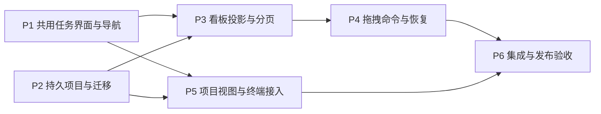

# 实施与验收计划

状态：原生首版已实现、验证并发布启动。当前进度见 [实现记录](implementation-status.md)，
已完成的验证见 [验证记录](validation.md)。下列矩阵作为交付检查依据。

## 1. 实施顺序



依赖关系表示代码集成顺序，不要求并行代理执行。P1–P5 已集成，项目与看板能力
默认启用；`RICHER_WORKSPACE_PROJECTS=0` 保留为兼容性排查开关。

### P1：保留原界面，建立共用状态

范围：`TerminalApp/Tasks`、`TerminalApp/Agents` 和薄导航接入。

- 抽出 TaskPageState / TaskActionController / DraftSessionStore。
- 列表与详情继续工作；看板视图入口先使用共用数据源与选择逻辑。
- AgentCatalogPage 接入全局入口、任务页入口和草稿返回栈。
- 保留原保存/保存并运行、消息队列、Run 详情、显式 Agent 更新、Stop/Close、
  Cancel/Done/Reopen/Retry/Derive/Finalize/Delete 等功能。

交付条件：移入新状态对象后原 Task/Agent 测试通过；页面重建、搜索刷新、项目切换
和管理页往返不丢草稿；看板不引入第二套 Task 生命周期逻辑。

### P2：项目目录、协议和数据库迁移

范围：TaskCore、TaskRuntime、Protocol/Client、SettingsModel 的可选 UI 元数据。

- 新增 ProjectCatalog、项目 CAS/receipt、目录绑定和归档策略。
- 按 schema 5 → 6 追加项目/看板基础表及项目背景快照字段，保持旧 ID 和上下文。
- 增加 `project_catalog` 能力和查询/命令；默认 Agent 继续使用原 Agent RPC。
- 实现 legacy 项目登记、候选目录恢复和歧义展示，不自动合并记录。
- 为项目归档增加统一调度/创建 guard，覆盖兼容客户端入口。

交付条件：备份/迁移/失败恢复通过；旧 Task、Run、Agent 配置版本和默认关系可读；
项目元数据修改不会改写旧执行上下文；同目录并发创建只有一个正常新项目。

### P3：摘要分页、看板与列表共享投影

范围：Store 查询、Runtime summary service、Tasks projection cache、XAML 看板。

- 增加有界摘要查询、完整状态计数、查询游标及选中 Task 的按需详情。
- 列表/看板共享实体缓存，分别保存可见顺序；分页不能当作全量快照覆盖。
- 实现四主列、受阻分组、待规划/已取消入口、当前/全部项目和原搜索/筛选。
- 接入 card-level 版本更新、列失效、epoch 重连和选中项滚动锚点。

交付条件：超过 512 项时可完整分页访问；5000 项计数准确；高频选中任务日志不触发
全看板重建；键盘和鼠标都能进入同一完整详情。

### P4：看板命令与持久操作

范围：BoardActionPolicy、Store 复合事务、RuntimeBoardActionService、UI 反馈。

- 先实现无执行副作用的排序和计划状态移动，再实现启动、返工、停止后移动。
- 复用 Run/消息/hold 校验原语；一个用户意图一个 command ID，最多一个活动 Run。
- 引入与 Run/intent 关联的 board operation，恢复 Pending、超时和冲突。
- 验收、取消、重试、交付清理、删除继续进入既有 Runtime 流程。
- 补齐逐项验收提交接口；确认全部通过与 Done/关闭 intent 同事务，旧历史不反推补写。
- 实现真实版本匹配的排序/计划调整撤销，明确不可撤销的执行和删除操作。

交付条件：每个交互状态表行都有正反测试；重复请求、断线、重启和异步交付竞争
不会重复 Run、丢消息或覆盖其他窗口的状态。

### P5：持久项目视图与终端生命周期

范围：TerminalApp/Projects、Workspace/WindowLayout 接口和 Tasks Surface 适配。

- 原 Workspace 侧边栏保留；项目工具栏与管理页面位于 TaskPanelHost，使用 ActiveProjectId。
- Task 内项目管理、项目库、空项目接入；Ctrl+N 和外层普通终端新建恢复原行为。
- 保存并恢复项目视图与各窗口布局；多窗口不互相覆写布局来源。
- 关闭 Task 内项目视图不关闭普通终端或 Task Surface；外层 Workspace 继续使用原关闭策略。
- 零实时 Tab 时项目页仍存在；原横向标签/CLI 临时会话行为保持原测试覆盖。

交付条件：至少两项目切换/关闭无异常；最后一个普通终端关闭后仍能使用任务页；
最后一个项目移出显示主页；后台 Run 不因视图操作中断或失去可重新连接的身份。

### P6：完整集成、兼容与发布

- 用真实 Runtime、Codex 和隔离目录验证已实现的执行/终端路径；不以网页演示替代。
- 验证原任务界面和 Agent 管理的完整回归，包括配置版本与 Task/Run 会话隔离。
- 验证协议 1.3/新 minor 的混合客户端、旧 Runtime 降级显示和 schema 回退备份。
- 检查中文/英文、大文本、高对比、Narrator、键盘、DPI 和窄窗口。
- 记录查询/滚动/卡片更新的实测预算以及上游热点变更范围。
- 通过统一 Release gate 后打包更新，保留 settings，检查真实启动的路径与产物。

## 2. 必须覆盖的验收矩阵

下列为原生实现的验收矩阵；“层”给出测试归属。实际通过的自动化与实机范围以
[验证记录](validation.md) 为准，矩阵本身不代表每一项都已人工执行。

| ID | 场景 | 必须观察到的结果 | 层 |
| --- | --- | --- | --- |
| PRJ-01 | 同目录重复打开/两窗口同时创建 | 定位已有 ID；不重复正常项目 | Core/Runtime/UI |
| PRJ-02 | 两目录同名项目 | ID、Task 和默认 Agent 独立 | Core/UI |
| PRJ-03 | 终端 cd 或切换活动 Surface | 项目根、任务范围不变化 | UI |
| PRJ-04 | 无 Task、无终端项目 | 能创建任务、管理默认 Agent，窗口保持可用 | UI |
| PRJ-05 | 项目移出/重开 | Task 和记录保留，布局引用可恢复 | UI/集成 |
| PRJ-06 | 归档时仍有 Run/排队/intent | 拒绝并列出待处理工作，不批量停止 | Core/Runtime |
| PRJ-07 | 归档/恢复空闲项目 | 不自动启动、清除 Task hold 或删除历史 | Runtime |
| PRJ-08 | 根目录缺失/更换/多根旧数据 | 原身份与冻结上下文保留，明确待绑定或派生流程 | 迁移/Runtime/UI |
| VIEW-01 | 列表 ↔ 看板 ↔ 完整详情 | 同 Task ID、筛选、选中、消息及执行历史 | UI |
| VIEW-02 | 从草稿进入 Agent 管理再返回 | 标题、验收、模型/指令、选择及修改意见均保留 | UI |
| VIEW-03 | 返回期间到达旧项目异步回复 | 不改当前选中项/表单，缓存按正确身份合并 | UI |
| VIEW-04 | 搜索隐藏选中卡片/任务被删除 | 有清楚的状态与导航，不把分页缺项当删除 | UI |
| BOARD-01 | 同列排序、筛选后排序、首尾落点 | 只更新对应列完整顺序，隐藏任务相对顺序保留 | Core/UI |
| BOARD-02 | 排序遇到另一窗口改顺序 | 列版本冲突并刷新，不静默覆盖 | Core/Runtime |
| BOARD-03 | 拖入进行中/双击/超时重发 | 一个 Queued Run、一个固定上下文和幂等结果 | Core/Runtime |
| BOARD-04 | 缺 Agent/配置过期/目录准备失败 | 草稿或已创建 Task 保留，不伪造运行成功 | Runtime/UI |
| BOARD-05 | 待验收退回修改 | 修改意见与 Run 原子关联，同 Task 增加执行记录 | Core/Runtime |
| BOARD-06 | 活动任务拖回待办，取消确认 | 状态、Run 和 hold 均不变 | UI/Runtime |
| BOARD-07 | 确认停止、超时、窗口退出、Runtime 重启 | 真实停止结果驱动落位，hold 持久，无隐式强杀 | Runtime |
| BOARD-08 | 停止同时 Agent 完成/提交验收 | 保留新交付，旧移动冲突，不停止新的 Run | Runtime |
| BOARD-09 | 活动/待领取消息/重试期间 Done | 拒绝；不会把卡片先显示成完成 | Core/Runtime/UI |
| BOARD-10 | Done 后终端关闭失败 | Done 与关闭恢复条件同时可见，内容不丢失 | Runtime/UI |
| BOARD-10a | 验收勾选/确认完成遇版本或运行冲突 | 验收值跨视图一致；失败无部分勾选、无部分 Done | Core/Runtime/UI |
| BOARD-11 | Done/Cancelled 仅拖回 Todo | 不自动领取历史消息或创建 Run | Core/Runtime |
| BOARD-12 | Agent 未报告交付但进程退出 0 | 不自动 InReview/Done，可见“未提交验收” | Runtime |
| BOARD-13 | rtask/旧命令/恢复改变状态或删除 | bucket、位置、计数和事件同步 | Core/协议 |
| BOARD-14 | 全部项目拖拽/跨项目目标 | 按真实归属执行，禁止隐式转移项目 | Runtime/UI |
| AGENT-01 | 修改公共 Agent 后旧 Task、排队 Run、历史重试 | 保持各自固定版本；显式更新 Task 才改变后续配置 | 现有 Core/Runtime + UI |
| AGENT-02 | 归档、恢复、同名 Agent | 旧任务可继续；不自动恢复默认；按 ID 消歧 | Core/Runtime/UI |
| AGENT-03 | 保存冲突、结果未知、刷新列表 | 草稿与 command ID 保留，不重复创建或覆盖配置 | 协议/UI |
| AGENT-04 | 两个 Task 使用同一 Agent | 会话、输入租约、capability 和工作目录仍隔离 | Runtime/集成 |
| AGENT-05 | 无项目、无 Task 时进入全局管理 | 全局 CRUD 可用，项目默认操作明确要求目标，不能创建占位 Task | Runtime/UI |
| CLOSE-01 | 关闭当前项目，另有项目 | 窗口保留，选择正确，集合无过期索引 | UI/实机 |
| CLOSE-02 | 关闭后台项目/多个终端 | 其他项目和普通终端不受误关影响 | UI/实机 |
| CLOSE-03 | 最后终端/最后项目视图 | 项目页/主页保持可用；显式窗口关闭才退出 UI | UI/实机 |
| CLOSE-04 | 任务 Surface 脱离后重开 | 后台继续，同 session/generation 恢复或明确刷新 | Runtime/UI |
| CLOSE-05 | 两窗口查看项目并打开同一任务终端 | 无第二输入控制器、无跨窗口强迁移 | Runtime/实机 |
| MIG-01 | schema 5：Task、默认 Agent、快照分别/共同存在 | 所有旧 ID 和历史引用保持，分阶段登记可重放 | Core/集成 |
| MIG-02 | 备份失败、事务中断、目录证据冲突 | 不部分升级，不合并不相关项目，不丢原库 | Core/集成 |
| MIG-03 | 旧 UI 与新 Runtime；新 UI 与旧 Runtime | 按能力降级，无未知字段解码失败或假操作 | 协议/UI |
| MIG-04 | 回退旧二进制 | 拒绝新 schema；能用备份恢复，升级后库另行保留 | 发布 |
| PAGE-01 | 0、500、513、5000 项及多项目 | 可访问全部任务、完整计数、有界响应 | Core/Runtime/UI |
| PAGE-02 | 翻页时状态/顺序变化，epoch 重置 | 去重、定向刷新、旧回复无效，不删除未加载条目 | 协议/UI |
| A11Y-01 | 键盘、Narrator、高对比、大文本、DPI | 所有动作可达，状态非颜色独占，焦点与文本可读 | 实机 |

已有 `WorkspaceCloseKeepsOtherWorkspaceOpen` 和
`WorkspaceCloseAllSurfacesKeepsOtherWorkspaceOpen` 继续覆盖旧模式；项目模式新增
自己的 CLOSE-01～05，不能通过修改旧断言来掩盖回归。

## 3. 性能与可维护性验收

性能数字是待测预算，以参考机器记录实测结果；不是宣称已经达到：

| 场景 | 预算/约束 |
| --- | --- |
| 点击、起拖、切换已有视图 | 100 ms 内出现反馈，业务 IO 全部异步 |
| 本地热查询首个 50 项摘要页 | 目标 p95 ≤ 200 ms；记录实际数据集/硬件 |
| 5000 Task 的看板 | 只创建已加载页/可见范围 UI，对全部任务不加载完整历史 |
| 单个活动 Task 高频日志 | 不全量重建列表/看板、不抢走输入焦点 |
| 项目/卡片刷新 | 合并失效事件，项目改名不重写所有 Task |
| rank 重排 | 在后台短事务完成；达到预算前完成区间化设计，禁止长时间阻塞写队列 |
| 响应大小 | 所有页、事件批次和错误内容均受协议帧上限与字段上限约束 |

新增手写文件接近 500 行时检查职责拆分。HTML 参考是单文件演示，不能据此把原生
导航、业务事务、拖拽、Agent 编辑和恢复逻辑都放进一个 TaskPage/Manager。

## 4. 验证、发布与文档更新

实现各阶段时运行与变更匹配的 Core、Runtime、Protocol 和 UI 测试，再执行根目录
规定的完整增量门禁：

```powershell
pwsh -NoLogo -NoProfile -File .\tools\deploy\test-workspace-release.ps1
pwsh -NoLogo -NoProfile -File .\tools\deploy\build-portable-release.ps1 -SkipBuild
```

新增测试选择器接入统一脚本。保留 bin、obj、生成目录和依赖缓存；不能分别用
不同全局属性编译包和 UI/Settings 测试，也不以 clean 重试未知故障。

最终交付记录应包含：对应设计条目、源码落点、正反/恢复测试、旧模式回归、真实
后台执行与 Surface 验证、迁移/回退、截图/可访问性结果、包校验和实际运行路径。
实现交付与验证覆盖分别记录：本次正式部署及迁移已完成，未执行的实机矩阵项目
继续在验证记录中明确列出，不能将自动化通过记为全部人工验收通过。
